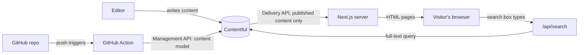

# Contentful Compass

A small, beginner-friendly website built with **Contentful** (headless CMS) and **Next.js**.
All text, images, navigation and pages on the site come from Contentful. Every article is a lesson about how Contentful works, so the site explains itself.

Features: responsive pages, article list with category filter, article pages with rich text, a **global search** (header dropdown + results page), and content created from code.

---

## 1. The idea in 60 seconds (explain this to your lead)



- **Contentful** stores content (articles, pages, navigation). Editors use its web UI. No code needed.
- **Next.js** asks Contentful's Delivery API for the content and renders pages.
- **Content model as code:** the structure of the content (content types and fields) is defined in `scripts/content-model.mjs`. Pushing to GitHub updates Contentful automatically.

## 2. Contentful concepts used here

| Concept | What it is | Where you see it |
|---|---|---|
| Space / environment | The project container and its `master` copy | Space ID in `.env.local` |
| Content type | Blueprint for a kind of content | `scripts/content-model.mjs` (10 types) |
| Entry | One piece of content made from a type | Each article, page, link |
| Asset | An uploaded file | Hero and article cover images |
| Reference | A field pointing to another entry | Article → Category, Page → Sections |
| Rich text | Formatted text stored as JSON | Article `body` |
| Publishing | Only published entries are visible | Draft vs published |
| Delivery API | Read-only, for the live site | `src/lib/contentful.ts` |
| Management API | Writes content types and entries | `scripts/` (never in the browser) |

### The 10 content types

| Type | Purpose |
|---|---|
| `siteSettings` | Site name, header menu, footer (one entry) |
| `link` | Label + URL, reused in menus |
| `page` | A URL made of ordered sections (`home`, `about`, ...) |
| `hero`, `featureGrid` (+ `feature`), `articleList`, `ctaBanner` | The building-block sections of a page |
| `article` | Lesson with rich text body, cover image, category |
| `category` | Groups articles |

## 3. How a page is built (the key pattern)

1. The URL `/about` hits `src/app/[slug]/page.tsx`.
2. It asks Contentful for the `page` entry with slug `about`.
3. The page has a list of **sections** (references). `src/components/sections.tsx` looks at each section's **content type ID** and renders the matching React component.

Result: editors can add, remove and reorder sections and create new pages in Contentful without a developer.

## 4. Global search

- `src/components/SearchBox.tsx` (client component in the header): waits 300 ms after typing, calls `/api/search?q=...`, shows a dropdown. **Enter** opens the full results page `/search?q=...`.
- `src/app/api/search/route.ts`: runs on the server, so the Contentful token never reaches the browser.
- `src/lib/contentful.ts` → `searchContent()`: uses Contentful's built-in full-text `query` parameter across `article` and `page` entries.

## 5. Project map

```
scripts/
  content-model.mjs   the content model as data
  create-model.mjs    npm run model  -> creates/updates content types
  seed.mjs            npm run seed   -> sample images, articles, pages, menu
src/
  lib/contentful.ts   all Contentful queries (one place)
  lib/types.ts        TypeScript shapes of the content
  components/         Header, SearchBox, Footer, sections, ArticleCard, RichText
  app/                routes: /, /[slug], /articles, /articles/[slug], /search, /api/search
.github/workflows/    contentful-sync.yml  (CI + model sync)
```

## 6. Run it

```bash
npm install
cp .env.example .env.local     # then fill in the values (see below)
npm run setup:contentful       # creates content types + sample content in Contentful
npm run dev                    # http://localhost:3000
```

Values for `.env.local` (Contentful → Settings):

| Variable | Where to find it |
|---|---|
| `CONTENTFUL_SPACE_ID` | Settings → General settings |
| `CONTENTFUL_ACCESS_TOKEN` | Settings → API keys → *Content Delivery API* token |
| `CONTENTFUL_MANAGEMENT_TOKEN` | Account → CMA tokens (only for `npm run model/seed`; **must belong to the account that owns the space**) |

`npm run model` and `npm run seed` are safe to run repeatedly: they update existing items instead of duplicating them.

## 7. GitHub automation

`.github/workflows/contentful-sync.yml` runs on every push to `main`: install, lint, type-check, and if `scripts/content-model.mjs` changed, run `npm run model`.
Add these in GitHub → Settings → Secrets and variables → Actions:
`CONTENTFUL_SPACE_ID`, `CONTENTFUL_MANAGEMENT_TOKEN` (optional `CONTENTFUL_ENVIRONMENT`).
Never commit tokens: `.env.local` is git-ignored.

## 8. Ideas to extend

Preview mode for drafts (Content Preview API), webhooks to rebuild on publish, localization, richer search (Algolia), images with focal points.
